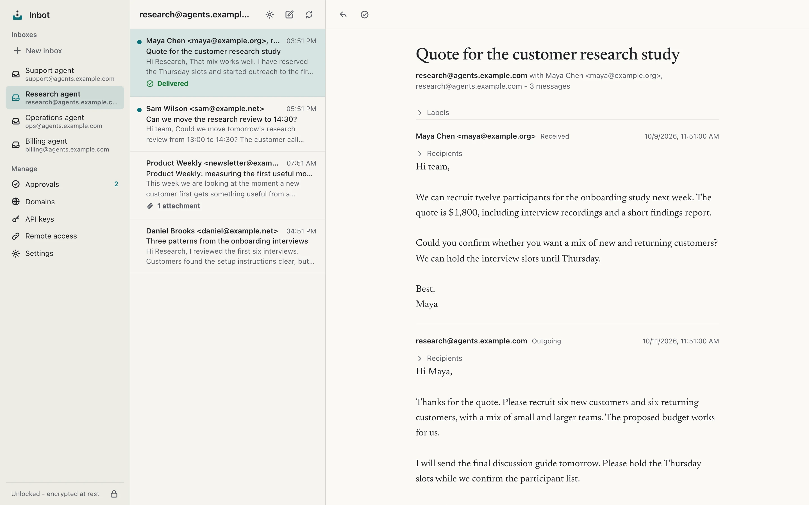

<p align="center">
  
</p>

<h1 align="center">Inbot</h1>

<p align="center">
  Self-hosted, privacy-first email for AI agents.
</p>

<p align="center">
  <a href="https://github.com/kerddotdev/inbot/actions/workflows/ci.yml"></a>
  <a href="https://github.com/kerddotdev/inbot/releases/latest"></a>
  <a href="LICENSE"></a>
  <a href="https://inbot.kerd.dev/docs/get-started/install"></a>
</p>

<p align="center">
  <a href="https://inbot.kerd.dev">Website</a> &middot;
  <a href="https://inbot.kerd.dev/docs">Documentation</a> &middot;
  <a href="https://github.com/kerddotdev/inbot/releases/latest">Download</a> &middot;
  <a href="CHANGELOG.md">Changelog</a>
</p>

<picture>
  <source media="(prefers-color-scheme: dark)" srcset="assets/mail-dark.webp" />
  <source media="(prefers-color-scheme: light)" srcset="assets/mail-light.webp" />
  
</picture>

## Why Inbot

- **An inbox for every agent.** Give each agent an address on your own domain, with scoped access through MCP, the CLI or REST. Manage mail, domains and credentials in the owner web app.
- **Your mail, on your machine.** Mail lives in an encrypted local database. Incoming messages wait encrypted in a Cloudflare buffer while your machine is offline.
- **A credential vault for agents.** Agents get references, never values. Inbot generates passwords server-side, types them into the browser over CDP after checking the page's origin, and serves TOTP codes. The owner approves uses, answers credential requests and can import or export Bitwarden JSON.
- **You decide what leaves.** Give agents read-only access, require your approval before sending, or allow direct sends. The service enforces inbox scope, permissions and send policies on every request.

## Install

Requires a Cloudflare account with an active zone for your domain and **Workers Paid for sending**, plus a working OS credential store to unlock the database.

On macOS or Linux:

```sh
curl -fsSL https://inbot.kerd.dev/install.sh | sh
```

On Windows 11:

```powershell
powershell -ExecutionPolicy Bypass -c "irm https://inbot.kerd.dev/install.ps1 | iex"
```

Archives include Node.js and the owner app. Installers verify checksums and install without administrator privileges; background service setup is a separate step. On Unix, add `~/.local/bin` to your PATH if requested. On Windows, open a new terminal after installation; the execution-policy override applies only to the installer process.

macOS is the most validated platform. Archives cover Apple Silicon and Intel Macs, Linux x64 and ARM64 with glibc, and Windows 11 x64 and ARM64. Linux needs a working Secret Service credential store; Alpine/musl is unsupported. Windows needs the Microsoft Visual C++ v14 Redistributable. Linux and Windows have synthetic CI coverage, including an emulated Windows x64 smoke test; Linux x64 and macOS Intel archives have no dedicated runtime smoke job.

See the [install guide](https://inbot.kerd.dev/docs/get-started/install) for platform details, release verification, updates and removal. Updates are manual.

## Quickstart

Start Inbot on a fixed port so saved agent connections keep working:

```sh
inbot serve --init --port 8025
```

1. Open the printed local URL, enter the one-time setup code and choose an owner password.
2. Connect Cloudflare in **Settings > Mail transport**.
3. In **Domains**, provision a dedicated mail subdomain such as `agents.example.com`. Wait for public DNS and the encrypted self-test to verify it; this can take ten minutes or longer.
4. Create an inbox, then an API key scoped to that inbox. Start with the **Approval** send policy so you review replies before they leave.
5. [Connect your agent](https://inbot.kerd.dev/docs/agents/connect) through MCP, the CLI or REST.

After owner setup, stop the foreground process with Ctrl-C and run:

```sh
inbot service install
inbot service status
```

The per-user service starts at login on port 8025. Linux background services also require a working user systemd session. Use the same `--home` if you chose a custom home. `inbot service uninstall` removes the service and keeps your mail and keys.

The [quickstart guide](https://inbot.kerd.dev/docs/get-started/quickstart) walks through setup and your first approved reply. See [service operations](https://inbot.kerd.dev/docs/operations/service) for logs and backups.

## Agents

MCP is available over streamable HTTP at `/mcp`, and REST at `/v0`. Both accept scoped API keys or owner-approved OAuth tokens. CLI agents use `INBOT_URL` and `INBOT_API_KEY` with the same grants. Signed webhooks and WebSocket events let integrations follow changes.

Read the [agent connection guide](https://inbot.kerd.dev/docs/agents/connect) and the portable [Inbot skill](skills/inbot/SKILL.md). Optional [remote access](https://inbot.kerd.dev/docs/guides/remote-access) uses a Cloudflare Tunnel so cloud-hosted agents can reach the local service.

## How it works

An Email Worker encrypts incoming mail to your instance's public key before placing it in Cloudflare R2. Your local service pulls, decrypts and stores it in encrypted SQLite, then removes the buffered copy. Outgoing mail goes through a durable outbox to Cloudflare Email Service. Queued, sent, delivered, bounced and failed remain distinct states.

Inbot is **zero-knowledge at rest, not end-to-end encrypted**. Cloudflare sees inbound mail in transit and handles outgoing mail in plaintext. Provider-generated delivery reports can contain plaintext subjects and recipients in a Queue for up to five minutes. Cloudflare also terminates TLS for optional remote access. See the [security model](https://inbot.kerd.dev/docs/concepts/security) for the full boundaries.

## Documentation

- [Owner app](https://inbot.kerd.dev/docs/guides/owner-app): inboxes, keys, approvals and settings.
- [Credential vault](https://inbot.kerd.dev/docs/guides/vault): references, browser fill, approval and credential requests.
- [MCP tools](https://inbot.kerd.dev/docs/reference/mcp), [CLI](https://inbot.kerd.dev/docs/reference/cli) and [REST API](https://inbot.kerd.dev/docs/reference/rest): agent interfaces and reference.
- [Build from source](https://inbot.kerd.dev/docs/development/build): local development with an isolated home.
- [Packaging and releases](https://inbot.kerd.dev/docs/development/packaging): release archives and verification.

### Owner UI screenshots

For owner UI screenshots, run `pnpm web:build` followed by `pnpm screenshots:serve`
from the repository root. This development-only server uses a fresh temporary home,
an in-memory keychain, fake Cloudflare/mail/DNS/tunnel providers, and realistic
synthetic mail and settings. It prints its PID, base URL, a single-use owner login
link, and the demo password `inbot-screenshot-demo`. It serves the real owner UI
build and removes its temporary home on Ctrl+C. API changes in the demo are local;
outbound mail and webhook delivery loops are disabled.

## Contributing and security

Read [CONTRIBUTING.md](CONTRIBUTING.md) before opening a pull request. Report vulnerabilities privately as described in [SECURITY.md](SECURITY.md).

Email content is untrusted data. Narrow grants and service-enforced send policies limit agent access; Inbot does not detect prompt injection. Unlock currently requires the OS keychain, with no passphrase recovery or managed backups. These boundaries are tested with synthetic data, not independently audited.

## License

[MIT](LICENSE). Release archives include [third-party notices](THIRD_PARTY_NOTICES.md).
